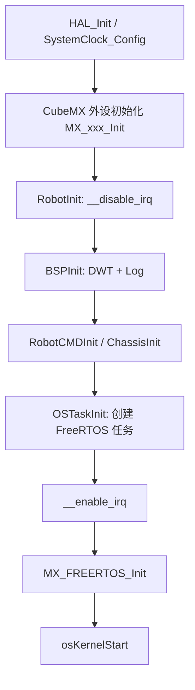

# basic_framework 工程架构分析

> 本文档基于对当前仓库(master 分支,HEAD `1a136eb`)源码的实际走读整理,用于快速理解工程分层、模块职责、任务模型与数据流。
> 相关文档:[README](../README.md)、[架构介绍与开发指南](./架构介绍与开发指南.md)、[VSCode+Ozone使用方法](./VSCode+Ozone使用方法.md)。

## 1. 总览

| 项目 | 说明 |
| --- | --- |
| 定位 | 湖南大学跃鹿战队 RoboMaster 电控通用嵌入式框架(fork 版本) |
| MCU | STM32F407IGH6(RoboMaster 开发板 C 型),主频 168MHz,HSE 8MHz |
| RTOS | FreeRTOS + CMSIS-OS v1(动态创建任务) |
| 工程生成 | STM32CubeMX(`basic_framework.ioc`) |
| 构建系统 | Makefile / Makefile.upgrade / CMakeLists.txt,arm-none-eabi-gcc 工具链 |
| 调试工具 | VSCode + Cortex-Debug(OpenOCD/JLink)+ SEGGER Ozone + RTT 日志 |
| CI | `.github/workflows/c-cpp.yml` |

启动文件 `startup_stm32f407xx.s`,链接脚本 `STM32F407IGHx_FLASH.ld`,外设地址映射 `STM32F407.svd`。

## 2. 分层结构

工程采用严格单向依赖的三层架构,外加 CubeMX 生成的 HAL 层:

```
application/          业务层:机器人逻辑与控制,硬件无关
    ↓
modules/              模块层:设备封装(电机/传感器/通信/算法/支持)
    ↓
bsp/                  板级支持层:片上外设封装,唯一允许出现 HAL 调用的自定义层
    ↓
Src/Inc/              CubeMX 生成的外设初始化、main.c、freertos.c
Drivers/              ST HAL + CMSIS 驱动
Middlewares/          FreeRTOS、USB CDC、CMSIS-DSP、SEGGER RTT
```

### 2.1 BSP 层 `bsp/`

每类外设一个 `bsp_xxx.c/h` 文件对:

| 外设 | 文件 | 说明 |
| --- | --- | --- |
| CAN | `bsp/can/` | 实例注册 + 过滤器 + 回调分发 + **环形队列非阻塞发送**(本 fork 改造) |
| USART | `bsp/usart/` | IDLE + DMA 接收,`HAL_UARTEx_RxEventCallback` 分发 |
| SPI / IIC | `bsp/spi/` `bsp/iic/` | 阻塞/IT/DMA,SPI 实例自带 CS 管理 |
| PWM | `bsp/pwm/` | 占空比/周期设置,DMA 发送 |
| GPIO | `bsp/gpio/` | 含 EXTI 中断回调 |
| ADC | `bsp/adc/` | **未实现(空)** |
| Flash | `bsp/flash/` | F407 扇区擦写 |
| DWT | `bsp/dwt/` | 微秒级计时/延时,系统时基 |
| Log | `bsp/log/` | 基于 SEGGER RTT 的 `LOGINFO/WARNING/ERROR` |
| USB | `bsp/usb/` | USB CDC 虚拟串口 |
| 工具 | `bsp/bsp_tools.c` | `CreateCallbackTask()`:把复杂回调升级为任务执行 |

**统一 Instance 模式**:

```c
XXXInstance *XXXRegister(XXX_Init_Config_s *conf);
```

- `XXXInstance` 内保存发送/接收缓存、`rx_id`、**回调函数指针**、以及指向上层模块对象的 `void *id`(parent pointer)。
- 中断收到数据后,bsp 层遍历实例匹配 id,调用 `module_callback`,模块回调再通过 `id` 强转回自己的实例对象,避免"底层包含上层头文件"。
- `BSPInit()`(`bsp/bsp_init.h`)只统一初始化必须的 `DWT` + `Log`,其余实例型外设在被注册时才初始化,未注册不占用资源。

### 2.2 Module 层 `modules/`

| 类别 | 模块 | 职责 |
| --- | --- | --- |
| 电机 | `motor/DJImotor` | DJI M2006/M3508/GM6020,4 电机分组 0x1FF/0x200/0x2FF 发送,三环串级 PID |
| | `motor/DMmotor` | 达妙电机,支持普通串级模式与 MIT 阻抗模式,自动使能/清错/恢复 |
| | `motor/HTmotor` | 海泰 HT04,自实现三环只发电流,每台电机独立任务 |
| | `motor/LKmotor` | 瓴控 LK9025,单总线最多 4 台 |
| | `motor/servo_motor` | PWM 舵机 + 总线舵机(0x55 0x55 帧) |
| | `motor/step_motor` | **未实现(空文件)** |
| | `motor/power_control` | DJI 电机功率模型控制,底盘功率限制 |
| 传感器 | `BMI088` | SPI 版 IMU 驱动,EXTI 触发读取,支持恒温加热 PID |
| | `ist8310` | IIC 三轴磁力计,EXTI-DRDY → IIC 读取 |
| | `TFminiPlus` | 北醒单点激光雷达(IIC,当前阻塞式) |
| | `imu/` | 旧版 IMU + `ins_task`(1kHz 姿态解算),计划迁移至 `BMI088` + `QuaternionEKF` |
| 通信 | `remote` | DJI DBus 遥控器(USART3)+ 富斯 FS 协议 |
| | `referee` | 裁判系统协议 v2.0.0 + UI 绘制 + 自定义控制器 + 图传链路 |
| | `master_machine` | 视觉/上位机 seasky 协议(USART1 或 USB VCP) |
| | `can_comm` | CAN 板间(多机)通信,自动分包/ CRC8 |
| | `bluetooth` | HC05 蓝牙串口透传 |
| | `super_cap` | 超级电容 CAN 控制与反馈 |
| 支持 | `daemon` | 软看门狗:注册/喂狗/离线回调 |
| | `message_center` | 应用层伪 pub-sub 消息中心 |
| | `alarm` | 蜂鸣器报警(daemon 任务内 100Hz 驱动) |
| | `algorithm` | PID、通用卡尔曼、四元数 EKF、CRC8/16、限幅等工具 |
| 规划中 | `standard_cmd` | 控制源统一封装为"标准指令"(仅文档,无实现) |
| | `unicomm` | 统一通信协议解析框架(仅文档,无实现) |
| | `encoder` | 光电/霍尔编码器支持(仅文档) |

**Module 设计要点**:
- 实例由 app 层通过 `XXXRegister/XXXInit` 创建,module 层只保存静态实例指针数组,不主动实例化。
- 算法模块(如 `algorithm/controller.c` 的 PID)与硬件无关,直接被电机模块或 app 调用。
- 通信类模块注册 daemon 监测离线,离线回调中重启串口/重新使能电机等。

### 2.3 Application 层 `application/`

| 应用 | 文件 | 职责 |
| --- | --- | --- |
| 总入口 | `robot.c/h` | `RobotInit()`、`RobotTask()`,按开发板宏条件编译 |
| 指令 | `cmd/robot_cmd.c` | 解析遥控器/视觉信息,发布各执行单元指令 |
| 底盘 | `chassis/chassis.c` | 麦轮/全向轮/舵轮/平衡底盘解算 + 功率控制 + 超电 |
| 云台 | `gimbal/gimbal.c` | yaw/pitch 双轴控制(**当前被注释**) |
| 发射 | `shoot/shoot.c` | 摩擦轮 + 拨盘 + 弹舱盖(**当前被注释**) |

- **机器人参数集中配置**在 `application/robot_def.h`:单/双板宏(`ONE_BOARD` / `CHASSIS_BOARD` / `GIMBAL_BOARD`)、机械参数(轮距/轴距/减速比/编码器对齐值)、以及 app 间通信的枚举与结构体定义。
- app 之间**无相互包含**,统一通过 message_center 话题通信(见第 4 节)。
- 双板配置下通过 `can_comm` 互发控制/反馈信息,由 `robot_def.h` 宏配合条件编译切换。

> 现状:当前 `robot.c:34-35` 中 `GimbalInit()`、`ShootInit()` 已被注释,工程实际运行 **RobotCMD + Chassis** 两个应用。

## 3. 运行时任务模型

初始化流程(`Src/main.c`):



FreeRTOS 任务(`application/robot_task.h`):

| 任务 | 优先级 | 周期 | 内容 |
| --- | --- | --- | --- |
| INS | AboveNormal | 1kHz(`osDelay(1)`) | `INS_Task()` 姿态解算 + `VisionSend()` 视觉回传 |
| MOTOR | Normal | 1kHz | `MotorControlTask()`:DJI 电机闭环、功率控制、DM 任务 |
| DAEMON | Normal | 100Hz(`osDelay(10)`) | `DaemonTask()` 软看门狗 + `BuzzerTask()` 报警 |
| ROBOT | Normal | ~200Hz(`osDelay(5)`) | `RobotTask()` = RobotCMDTask + ChassisTask |
| UI | Normal | 事件式 | 裁判系统 UI 刷新 |
| (动态) | — | 高频 | HT 电机每注册一台创建一个独立任务 |

> 注意:`daemon.md` 中描述为 1kHz,与实现(100Hz)不符;以代码为准,超时时间 = `reload_count × 10ms`。

## 4. 数据流与 pub-sub 机制

### 4.1 消息中心 `message_center`

伪 pub-sub 实现(仅隔离 app 层):

| API | 说明 |
| --- | --- |
| `PubRegister(name, data_len)` | 注册发布者,返回 `Publisher_t*` |
| `SubRegister(name, data_len)` | 注册订阅者(话题不存在则先建发布者节点) |
| `PubPushMessage(pub, data)` | 向该话题所有订阅者队列推数据 |
| `SubGetMessage(sub, buf)` | 从订阅者队列取数据,空返回 0 |

- 数据结构:发布者链表 + 每话题的订阅者链表 + 每订阅者长度 1 的环形队列(数组模拟 FIFO)。
- 约束:同一话题数据长度必须一致;一个订阅者只订阅一个话题;队列满丢弃最旧数据。

### 4.2 现有话题

| 话题 | 发布者 | 订阅者 | 数据 |
| --- | --- | --- | --- |
| `chassis_cmd` | robot_cmd | chassis | `Chassis_Ctrl_Cmd_s` |
| `chassis_feed` | chassis | robot_cmd | `Chassis_Upload_Data_s` |
| `gimbal_cmd` | robot_cmd | gimbal | `Gimbal_Ctrl_Cmd_s` |
| `gimbal_feed` | gimbal | robot_cmd | `Gimbal_Upload_Data_s` |
| `shoot_cmd` | robot_cmd | shoot | `Shoot_Ctrl_Cmd_s` |
| `shoot_feed` | shoot | robot_cmd | `Shoot_Upload_Data_s` |

### 4.3 完整数据流

```
DBus遥控(USART3) ┐
视觉/上位机(UART1或USB VCP, seasky帧) ┤→ RobotCMD 解算 → message_center
                                        │      ├ chassis_cmd → chassis → motor → bsp_can → 电调
                                        │      ├ gimbal_cmd  → gimbal  → motor → bsp_can
                                        │      └ shoot_cmd   → shoot   → motor → bsp_can
                                        └← feed 话题回传反馈(姿态/热量/状态)

裁判系统(USART6) ←→ referee(UI/热量/弹速) ─ chassis
超级电容(CAN)    ←→ super_cap              ─ chassis
板间通信(CAN)    ←→ can_comm               ─ robot_cmd / chassis(双板模式)
```

控制下行链路示例(以底盘电流闭环为例):
`chassis ∈ motor ∈ bsp_can`,即 chassis 应用包含电机模块,电机模块包含 CAN 实例,逐层组装实现功能。

## 5. 关键设计模式

1. **C 语言面向对象**:结构体即对象,`XXXRegister(conf)` 构造实例并返回 `this` 指针,所有接口首参传入实例指针。
2. **回调 + parent pointer**:bsp 实例保存模块回调与 `void *id`,中断触发时反向调用上层,依赖单向不逆流。
3. **软件看门狗 daemon**:被监测模块周期性 `DaemonReload()`;超时调用注册的离线回调(参数为 `owner_id`),支持多实例区分。
4. **消息中心解耦 app**:app 之间不互相 include,仅依赖话题名与数据结构。
5. **HAL 隔离**:仅 bsp 层允许出现 `HAL_*` 调用;更换 MCU 时主要重写 bsp 接口,module/app 基本不动。

## 6. 现状与待办

| 问题 | 位置 | 说明 |
| --- | --- | --- |
| 半成品模块 | `modules/standard_cmd`、`modules/unicomm` | 仅设计文档,`.c/.h` 为 0 字节 |
| 未实现外设 | `bsp/adc`、`modules/motor/step_motor`、`modules/encoder` | 空实现或仅文档 |
| 旧 IMU 迁移 | `modules/imu/` | 计划迁移至 `BMI088` + `algorithm/QuaternionEKF` |
| app 被裁剪 | `application/robot.c` | Gimbal/Shoot 初始化与任务被注释,当前仅 CMD+Chassis 生效 |
| 文档与实现出入 | `README.md`、`daemon.md` | README 描述完整步兵;daemon 频率描述 1kHz vs 实现 100Hz |
| 文件名乱码 | `application/APP应用层编写指南.md` 等 | 中文文件名编码混用,UTF-8 环境显示异常 |
| 阻塞式驱动 | `modules/TFminiPlus` | 当前阻塞 IIC,文档注明需改为中断 |

## 7. 开发约定速查

- 代码风格:函数动宾短语大驼峰;变量下划线小写;类型 `_t`(简单数据)/ `_s`(复杂结构)/ `XXXInstance`(外设实例)。
- 所有模块接口统一命名为 `XXXRegister()`(含单实例模块)。
- CubeMX 生成文件(尤其 `main.c`、`freertos.c`)的用户代码必须写在 `USER CODE BEGIN/END` 注释块内。
- 新增模块需附带说明文档:总体说明、代码结构、外部接口与类型定义、私有函数/变量、使用范例。
- 物理量统一使用标准单位制,转换宏放 `modules/general_def.h`。
